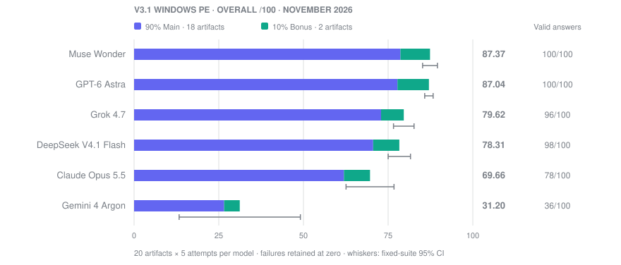

# AgentRE-Bench current Windows PE results

Updated **November 5, 2026**. Website release **v3.1**; rubric **v3.4**; scoring version **`6.2.0+exact-claim-review-20261105`**. Six model configurations, ten programs, 20 stripped/unstripped artifacts, five attempts per artifact: **600 episodes**.



## Scores and coverage

All scores below are out of 100. Overall averages five planned attempts per artifact and weights the 20 artifacts equally: 90% Main (Levels 14–22) and 10% Bonus (Level 23). Refusals and budget exits retain zero.

| Model | Overall | Individual 95% interval | Main | Bonus | Valid answers | Access |
| --- | ---: | ---: | ---: | ---: | ---: | --- |
| Muse Wonder | **87.3681** | 85.18–89.56 | 87.3677 | 87.3720 | 100/100 | API |
| GPT-6 Astra | **87.0438** | 85.80–88.29 | 86.4016 | 92.8240 | 100/100 | API |
| Grok 4.7 | **79.6204** | 76.59–82.65 | 81.0181 | 67.0410 | 96/100 | API |
| DeepSeek V4.1 Flash | **78.3077** | 75.01–81.60 | 78.4254 | 77.2480 | 98/100 | API |
| Claude Opus 5.5 | **69.6560** | 62.57–76.74 | 68.8363 | 77.0330 | 78/100 | API |
| Gemini 4 Argon | **31.1994** | 13.30–49.10 | 29.5297 | 46.2270 | 36/100 | API |

These are rubric scores, not percentages of fully solved tasks. A valid answer meets the submission format. **Full-credit success is 0/100 for every model, or 0/600 overall**, using final score exactly 1.0 as the criterion.

| Model | Conditional answer quality /100 | Artifacts answered | Refusals / blocks | Budget exits | Thinking |
| --- | ---: | ---: | ---: | ---: | --- |
| Muse Wonder | 87.3681 | 20/20 | 0 | 0 | High |
| GPT-6 Astra | 87.0438 | 20/20 | 0 | 0 | Extra high |
| Grok 4.7 | 82.9673 | 20/20 | 0 | 4 | High |
| DeepSeek V4.1 Flash | 80.0294 | 20/20 | 0 | 2 | Max |
| Claude Opus 5.5 | 89.3982 | 19/20 | 22 | 0 | High |
| Gemini 4 Argon | 85.3845 | 18/20 | 64 | 0 | High |

Conditional quality averages valid answers within each answered artifact, then gives those artifacts equal weight. Models answered different subsets; this is not a separate capability ranking. Across the roster, 508 attempts produced valid answers, 86 ended in refusal/block outcomes, and six exhausted the budget.

## DeepSeek addition and scoring review

DeepSeek V4.1 Flash completed 100 new episodes on the frozen artifacts on November 4–5, 2026. Its 98 valid answers and two budget exits remain in the denominator. Two `URLError` requests recovered through identical-request retries; no terminal infrastructure failure or failed episode was discarded. The requested and echoed model ID was `deepseek-flash`, a mutable alias mapped by the provider to DeepSeek-V4.1-Flash-1017 at collection. No immutable weight identifier was returned.

The base scorer gave DeepSeek 75.9084/100. Review of 219 additional literal-claim interpretations, including one negation-scope correction, produced **78.3077/100**. Seventy-four episode totals changed: 68 increased and six decreased. False assertions retain their penalties. The same exact-claim registry was applied to all six models; the previous 500 episode scores are numerically unchanged.

No binaries, ground truths, weights, or saved answers were changed, and semantic review made no new model inference calls. The original five-model collection had previously been rescored from v3.2/scorer 5.0 to v3.4/scorer 6.2.0. The November result is a disclosed retrospective scoring update, not a claim that all runs originally used the final interpretation rules.

## Verification and uncertainty

A separate AI agent independently reproduced **all 600 baseline and all 600 reviewed score objects**, checked source/evidence hashes and historical provenance, inspected all 219 mappings, and found no numerical blocker. Its verdict is **QUALIFIED**: correct under the frozen rubric and versioned ledger. All eight supplied review regressions passed, alongside 23 independent static/log checks and 13 additional adversarial checks. See the [audit summary](results/v3-1/audit-summary.json).

The review is AI-assisted and post-hoc, not independent human certification. Forty-six source-supported mappings still receive fixed-rubric precision penalties because they concern facts outside the allowed set or observations placed in another field. Scores and unmatched-claim counts therefore cannot be treated as pure factual accuracy or a hallucination rate.

Individual 95% intervals use Student t across the five complete-suite repetition means. Pairwise comparisons use Welch intervals with Bonferroni protection across all **15** pairs. Muse minus Astra is **+0.3243 points**, with simultaneous 95% interval **−3.8203 to +4.4689**. DeepSeek minus Grok is **−1.3127 points**, with interval **−7.9809 to +5.3555**. Both include zero; the recorded ordering does not establish repeat-run superiority.

Intervals describe repeated performance on these fixed public artifacts. Twenty artifacts represent ten programs, and 600 episodes are not 600 independent tasks. The different reasoning settings, effective token limits, client behavior, and collection dates prevent a controlled compute comparison. The public suite does not establish held-out generalization or rule out contamination.

## Downloads and reproduction

- [Interactive report](https://www.agentre-bench.ai/results/v3-1/)
- [JSON results, configurations, intervals, and provenance hashes](results/v3-1/scores.json)
- [Summary CSV](results/v3-1/scores.csv) and [artifact CSV](results/v3-1/artifact-scores.csv)
- [Public numeric records for all 600 episodes](results/v3-1/reviewed-episodes.json)
- [Field findings and selected previously published examples](results/v3-1/findings.json)
- [Independent AI audit summary](results/v3-1/audit-summary.json)
- [Preserved October five-model results](results/v3-1/archive/20261025/scores.json)
- [Scoring contract and review history](scoring.md)

From the repository root:

```bash
python3 -m pip install -r scripts/requirements-site.txt
python3 scripts/build_site_results.py
python3 scripts/build_github_results.py
```

These commands reproduce the presentation and aggregates from public numeric records without model calls. They do not regrade the raw answers; the current complete answer/log archive and grading evidence are not part of this public presentation update. Original answer, report, review-ledger, and adapter hashes remain in the published provenance.

## Historical and incomplete runs

The [August V3 report](../version3/ANALYSIS.md) uses one attempt per artifact and the older Main-plus-Bonus total. Its Kimi K3 results are not included in this five-attempt leaderboard. The stopped Kimi K3.1, GLM 5.3, and GLM Flash campaigns are incomplete and excluded. No new Kimi regrade is included in this release.

The binary corpus is unchanged. Its authored code and constants support static-analysis tasks; routine names do not establish working cryptography or successful execution. Synthetic S-box/XOR routines are not standard AES, Level 18’s syscall invocation stub is nonfunctional, and Level 22’s authored TLS routine is not registered. The samples are never executed during evaluation.
